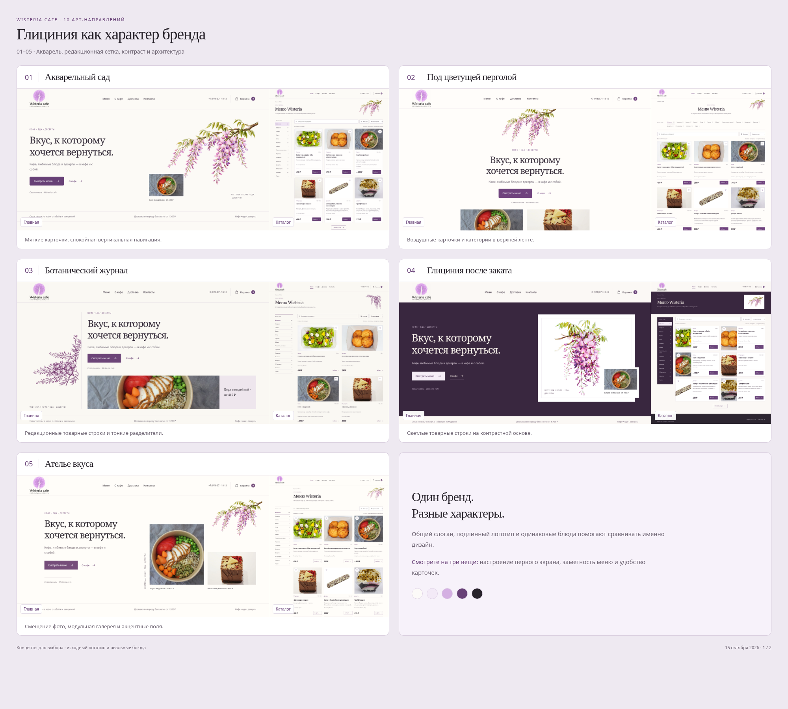
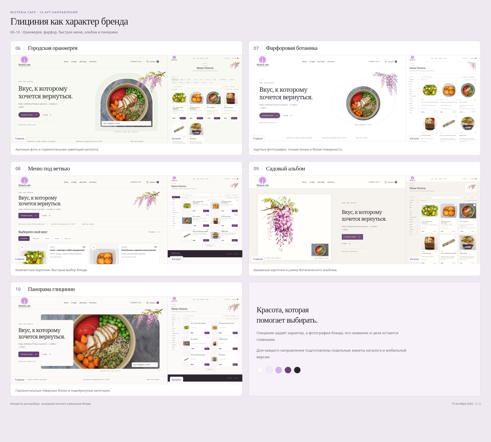

# Wisteria cafe · 10 направлений дизайна

Десять самостоятельных вариантов для выбора будущего облика кафе: от воздушной ботаники до компактного меню. Каждый вариант включает главную страницу и каталог на компьютере и телефоне.

**[Открыть PDF со всеми направлениями](Wisteria-10-design-directions.pdf)** · [Обзор 01–05](board-1.png) · [Обзор 06–10](board-2.png)

**С чего начать выбор:** 01 «Акварельный сад» — преемственность фирменного стиля; 07 «Фарфоровая ботаника» — минимализм и воздух; 08 «Меню под ветвью» — быстрый переход к категориям и блюдам.

Ниже — **40 реальных снимков браузера**: по четыре на каждое направление. Ширина настольной версии — **1440 px**, мобильной — **390 px**. Нажмите на нужную ссылку, чтобы рассмотреть макет целиком.

| Направление | Композиция | Главная · 1440 | Меню · 1440 | Главная · 390 | Меню · 390 |
| --- | --- | --- | --- | --- | --- |
| **01 · Акварельный сад** | Спокойный светлый диптих: текст и живая ветвь в двух самостоятельных колонках. | [Смотреть](screens/01-home-desktop.png) | [Смотреть](screens/01-menu-desktop.png) | [Смотреть](screens/01-home-mobile.png) | [Смотреть](screens/01-menu-mobile.png) |
| **02 · Под цветущей перголой** | Центральная композиция под цветущей ветвью, с парой фотографий в нижнем ряду. | [Смотреть](screens/02-home-desktop.png) | [Смотреть](screens/02-menu-desktop.png) | [Смотреть](screens/02-home-mobile.png) | [Смотреть](screens/02-menu-mobile.png) |
| **03 · Ботанический журнал** | Редакционная сетка, вертикальная гравюра, крупная типографика и горизонтальные карточки. | [Смотреть](screens/03-home-desktop.png) | [Смотреть](screens/03-menu-desktop.png) | [Смотреть](screens/03-home-mobile.png) | [Смотреть](screens/03-menu-mobile.png) |
| **04 · Глициния после заката** | Глубокий сливовый первый экран и ботаника на светлой бумажной поверхности. | [Смотреть](screens/04-home-desktop.png) | [Смотреть](screens/04-menu-desktop.png) | [Смотреть](screens/04-home-mobile.png) | [Смотреть](screens/04-menu-mobile.png) |
| **05 · Ателье вкуса** | Асимметричная композиция из текста, двух фото и свободного ботанического угла. | [Смотреть](screens/05-home-desktop.png) | [Смотреть](screens/05-menu-desktop.png) | [Смотреть](screens/05-home-mobile.png) | [Смотреть](screens/05-menu-mobile.png) |
| **06 · Городская оранжерея** | Архитектурная арка, фотография в окне и свисающая глициния по краю. | [Смотреть](screens/06-home-desktop.png) | [Смотреть](screens/06-menu-desktop.png) | [Смотреть](screens/06-home-mobile.png) | [Смотреть](screens/06-menu-mobile.png) |
| **07 · Фарфоровая ботаника** | Белая основа, круглая фотография, тонкая гравюра и деликатные линии. | [Смотреть](screens/07-home-desktop.png) | [Смотреть](screens/07-menu-desktop.png) | [Смотреть](screens/07-home-mobile.png) | [Смотреть](screens/07-menu-mobile.png) |
| **08 · Меню под ветвью** | Компактный первый экран: категории и блюда появляются сразу, ботаника расставляет акценты. | [Смотреть](screens/08-home-desktop.png) | [Смотреть](screens/08-menu-desktop.png) | [Смотреть](screens/08-home-mobile.png) | [Смотреть](screens/08-menu-mobile.png) |
| **09 · Садовый альбом** | Полная исходная акварель в высокой рамке, текст отдельной узкой колонкой. | [Смотреть](screens/09-home-desktop.png) | [Смотреть](screens/09-menu-desktop.png) | [Смотреть](screens/09-home-mobile.png) | [Смотреть](screens/09-menu-mobile.png) |
| **10 · Панорама глицинии** | Широкое фото блюда, молочная текстовая карточка и ветвь вдоль верхнего края. | [Смотреть](screens/10-home-desktop.png) | [Смотреть](screens/10-menu-desktop.png) | [Смотреть](screens/10-home-mobile.png) | [Смотреть](screens/10-menu-mobile.png) |

Во всех направлениях одинаковый слоган **«Вкус, к которому хочется вернуться.»**, родной логотип Wisteria cafe и фотографии настоящих блюд. Это помогает сравнивать композицию, навигацию и карточки. Новая широкая акварель и гравюра для концептов созданы с помощью `image_gen` на основе вашего референса; исходная вертикальная иллюстрация также сохранена.

В папке находятся **20 адаптивных HTML-макетов** — по главной и каталогу для каждого направления. [HTML-галерея](lookbook.html) предназначена для просмотра вместе с файлами этой папки при локальном запуске или на статическом хостинге. В демонстрации используются шесть товаров; макеты не принимают заказы. Основное меню из **431 позиции** сохранено без изменений.

**[Действующий сайт Wisteria cafe](https://lucky-man2985.github.io/Wisteria-cafe/)** остаётся отдельной рабочей версией. В нём заменён заголовок H2 «Вкус, к которому хочется вернуться.», рисунок показан целиком с сохранением пропорций. Представленные десять направлений подготовлены для выбора и не заменяют действующий сайт.

Материалы этой галереи размещены в папке `botanical-directions/` ветки `design/wisteria-botanical-10-2026-10-15`.

Независимое ревью по процессу **«Джинн»** выявило и помогло исправить контраст мелкого текста и кадрирование длинных десертов. [Итоговый отчёт](../docs/changes/WC-DESIGN-03/evidence/directions-review/review.md). Проверки демонстрационных действий: 93/93; это не испытания реального оформления заказа.

Исправленный блок действующего сайта: [компьютер](../docs/changes/WC-DESIGN-03/evidence/fix-review/brand-pause-1440.png) · [телефон](../docs/changes/WC-DESIGN-03/evidence/fix-review/brand-pause-390.png).
