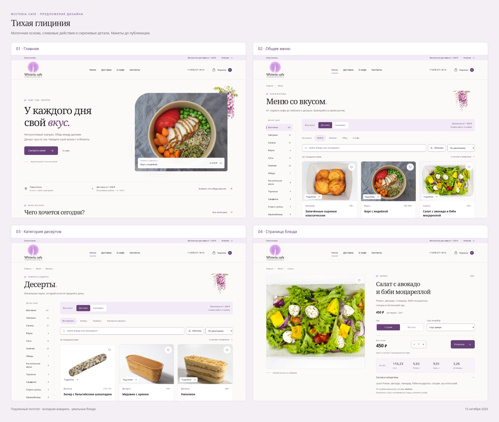
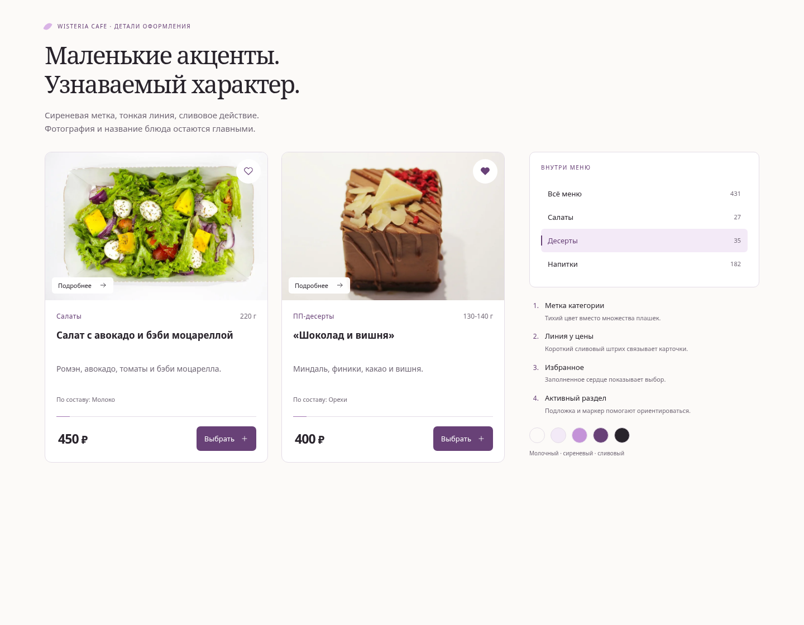
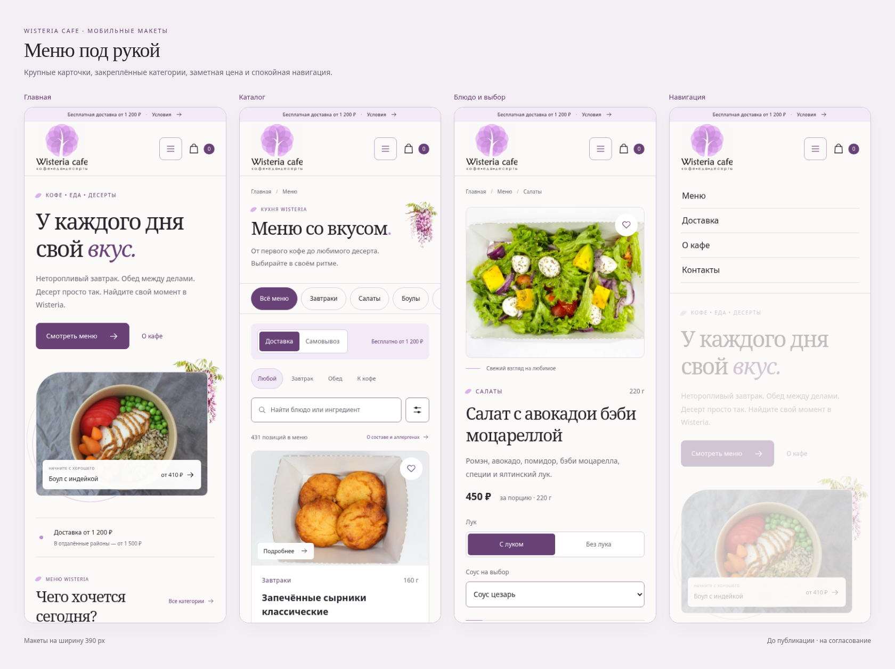
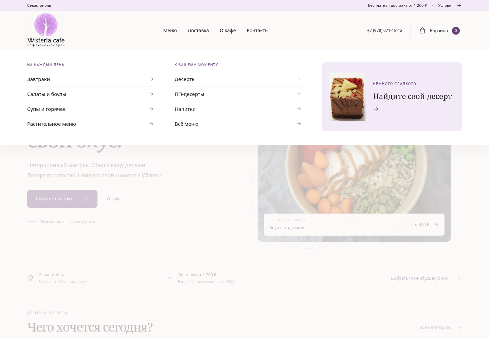

# Wisteria cafe — макеты «Тихая глициния»

Макеты от 15 октября 2026 **приняты пользователем и реализованы**.
**[Открыть опубликованный сайт](https://lucky-man2985.github.io/Wisteria-cafe/)**.
Ниже сохранены согласованные макеты для сравнения. Код изменённых исходников — в ../release-source/.

Картинки ниже открываются прямо в GitHub: скачивать архив для просмотра не нужно.
Нажмите изображение, чтобы рассмотреть его крупнее.

## Общий вид страниц

Полные макеты:

| Страница | Компьютер | Телефон |
| --- | --- | --- |
| Главная | [Открыть](home-1440.png) | [Открыть](home-390.png) |
| Общее меню | [Открыть](menu-1440.png) | [Открыть](menu-390.png) |
| Категория «Десерты» | [Открыть](desserts-1440.png) | [Открыть](desserts-390.png) |
| Страница блюда | [Открыть](product-1440.png) | [Открыть](product-390.png) |
| Раскрытая навигация | [Открыть](navigation-1440-top.png) | [Открыть](navigation-390-top.png) |

## Карточки и фирменные детали

- **Категория и вес:** категория выделена сливовым цветом, вес стоит отдельно.
- **Разделитель у цены:** тонкая линия с коротким цветным началом объединяет карточки.
- **Избранное:** белая круглая кнопка; выбранное сердце заполнено сливовым цветом.
- **Активная категория:** светлая сирень и вертикальный маркер на компьютере;
  сливовая кнопка на телефоне.
- **Заголовки:** маленький лепесток и свободное пространство вместо обилия декора.
- **Фото главной:** один мягкий угол и тонкие дуги, отсылающие к округлой кроне логотипа.
- **Акварель:** исходная глициния у края вводного блока, без рисунков за ценами и текстом.

## На телефоне

Карточки в одну колонку. Лента категорий закреплена под шапкой. На странице блюда
базовая цена видна перед выбором вариантов, итоговая сумма остаётся возле действия.

## Раскрытое меню

Группы категорий разделены по смыслу. Акцентный блок ведёт к десертам.
В мобильной версии — крупные строки с понятными разделителями.
Для этого макета показаны основные пункты шапки. Разделы «Для офиса» и «Блог»
из действующего сайта не удалены; окончательное расположение определится при переносе дизайна.

## Что сохранено и что проверено

Подлинные логотип, акварель, фото и локальные Noto Serif/Noto Sans.
Данные 431 позиции целиком сохранены в `review-data.json`; на экранах показана выборка.
Короткие отображаемые названия не меняют исходные названия и варианты блюд.
Метки «хит», «новинка», отзывы и зачёркнутые цены не добавлялись.

Проверены 6 макетов × 4 ширины (360, 390, 768, 1440 px): переполнение документа,
загрузка картинок и ошибки JS. Отдельно проверены избранное, пустой поиск,
быстрый просмотр с реальными данными, мобильное меню и счётчик количества.
Исходные 18 файлов ассетов совпадают с оригиналами по SHA-256.

HTML — отдельный прототип для проверки дизайна, а не полноценная замена сайта.
Показана часть каталога; сортировка, подбор всех категорий и полный заказ здесь
не реализованы. Данные не отправляются, оплата отсутствует.

После согласования выбранные решения можно перенести в шаблоны действующего сайта,
сохранив его полный каталог, маршруты и рабочие сценарии.
